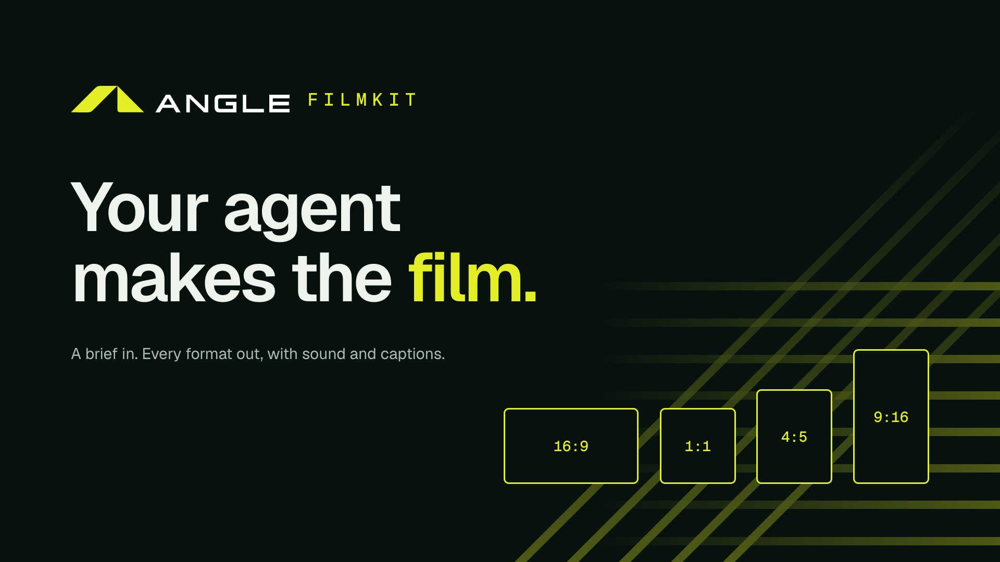
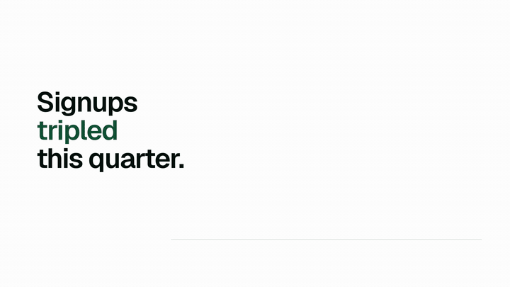
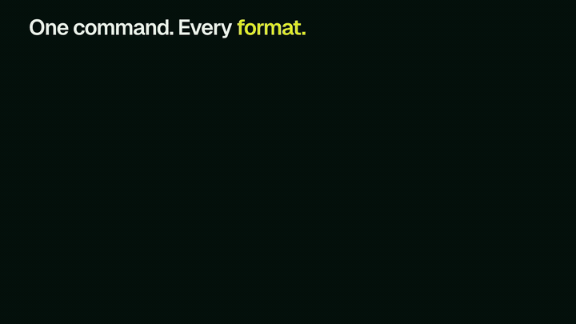
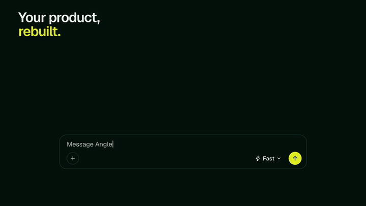
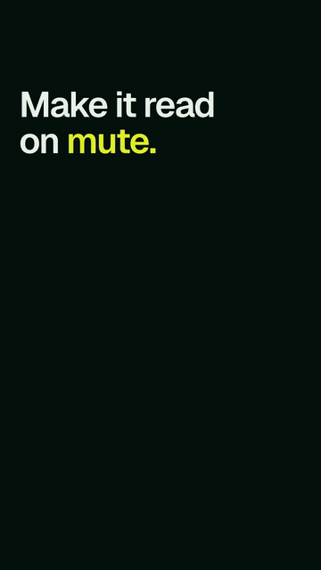

<p align="center"><a href="docs/assets/teaser.gif"></a></p>

# Angle Filmkit

**Your AI agent makes the film.** Write a brief. The agent researches it, builds the film from filmkit's scenes,
checks every format, looks at its own frames and renders. You get **16:9, 1:1, 4:5 and 9:16** videos with sound made
from the motion and SRT/VTT captions.

> **Status: pre-alpha.** The kit behind it already made Angle's launch film, eight feature clips and three hook loops.
> Angle Filmkit turns it into a tool anyone with an agent can use. Follow the v0.1 epic in the issues.

Made by [Angle](https://github.com/AngleOS), the private AI that runs open models on GPUs that already exist. Out of
the box, films get Angle's look: a Night ground, a Pear accent, Geist and the brand lines. They carry your logo, and
you can retheme them completely.

## How it works
- **Films are HTML.** Scenes are HTML with GSAP timelines, rendered to video by
  [HyperFrames](https://github.com/heygen-com/hyperframes) (pinned, so a re-render is identical). Agents write code
  well, and you can diff and review a film like any code.
- **One master, four frames.** Each format is laid out for its own frame, never cropped. Every word stays clear of the
  feeds' buttons.
- **A kit with taste:**
  - title entrances and a logo reveal;
  - product UI scenes: chat, code, terminal;
  - infographic scenes: bars, counters, stats, grids, cards, timelines, meshes, meters.
  
  Motion rules hold them together.
- **Sound from the picture.** Impacts, ticks and whooshes come from the motion, over a tonal pad, mastered to −19
  LUFS. There's no licensed music.
- **Every word has a source.** A claims ledger keeps the film honest. Lines that aren't true yet are flagged ⚑ and
  hold back posting.
- **Built for agents:**
  - an MCP server whose tools return the frames as images, so the model can see what it made;
  - a skill that teaches the whole brief → research → build → check → look → render workflow.

## Examples
Short films made with the kit. Each one is a few dozen lines of HTML, and the data is example data.

[`examples/studio`](examples/studio) is Angle Filmkit's own studio: its films with their briefs, sound, claims and
posting copy, checked in every format by CI. [Films are code](examples/studio/films/films-are-code) is the argument
film, built on the infographic scenes; [Brief in, film out](examples/studio/films/brief-in-film-out) is the product
demo, built on the terminal, chat and UI scenes; [The four frames](examples/studio/films/the-four-frames) is a 9:16
hook that loops without a seam.

<table>
<tr>
<td width="50%"><br><sub><b>Infographic</b> · bars drawn to scale with rolling values, on the light Paper theme</sub></td>
<td width="50%"><br><sub><b>Developer promo</b> · a terminal typed at reading speed</sub></td>
</tr>
<tr>
<td width="50%"><br><sub><b>Product promo</b> · product UI rebuilt from tokens, never screen-recorded</sub></td>
<td width="50%" align="center"><br><sub><b>9:16 hook</b> · laid out for the vertical frame, not cropped from 16:9</sub></td>
</tr>
</table>

Their sources are in [`brand/films/`](brand/films). The header animation is a film too.

## Install (one line)
> Coming in v0.1: the installers are here, and `filmkit setup` and the CLI commands below are being built (#3, #19).

```sh
curl -fsSL https://raw.githubusercontent.com/AngleOS/filmkit/master/install.sh | sh     # macOS, Linux
irm https://raw.githubusercontent.com/AngleOS/filmkit/master/install.ps1 | iex           # Windows
npx -y github:AngleOS/filmkit setup                                                      # anywhere with Node 20.12+
```
It installs Node and ffmpeg if they're missing. Then `filmkit setup` walks you through:
- **connecting Filmkit to your agent tools:** it detects Claude Code, Claude Desktop, Codex, Cursor, VS Code (Copilot),
  Windsurf, Zed, Gemini CLI and opencode, and registers the MCP server and skill in each;
- **making a studio;**
- **setting up your brand:** from your website, or by answering a few questions;
- **making a first film.**

`--yes` runs it unattended, and `npx -y github:AngleOS/filmkit setup --remove` undoes it.

> Filmkit isn't on npm yet, so run it as `npx -y github:AngleOS/filmkit …`, never an unscoped `npx filmkit`.

### Or let your agent do it
Paste [this prompt](docs/install-with-your-agent.md) into your agent (or run `npx -y github:AngleOS/filmkit prompt`). It installs and
configures Filmkit, asks you only for your brand, and finishes with a first film.

## Use it
```sh
npx -y github:AngleOS/filmkit new launch --template statement   # or ask your agent: "Make a 30-second launch film for …"
npx -y github:AngleOS/filmkit check launch                       # every format; non-zero on failure
npx -y github:AngleOS/filmkit contact launch                     # contact sheets to review
npx -y github:AngleOS/filmkit render launch                      # renders/launch-{16x9,1x1,4x5,9x16}.mp4 + .srt/.vtt
```
Requirements: Node ≥ 20.12 and ffmpeg. The installer handles both.

## Licence
The code is MIT. Third-party pieces keep their own licences (`THIRD_PARTY.md`). The Angle name and logo are trademarks
and aren't covered by the MIT licence (`TRADEMARKS.md`).
